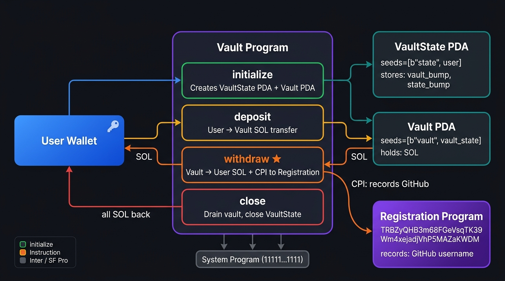
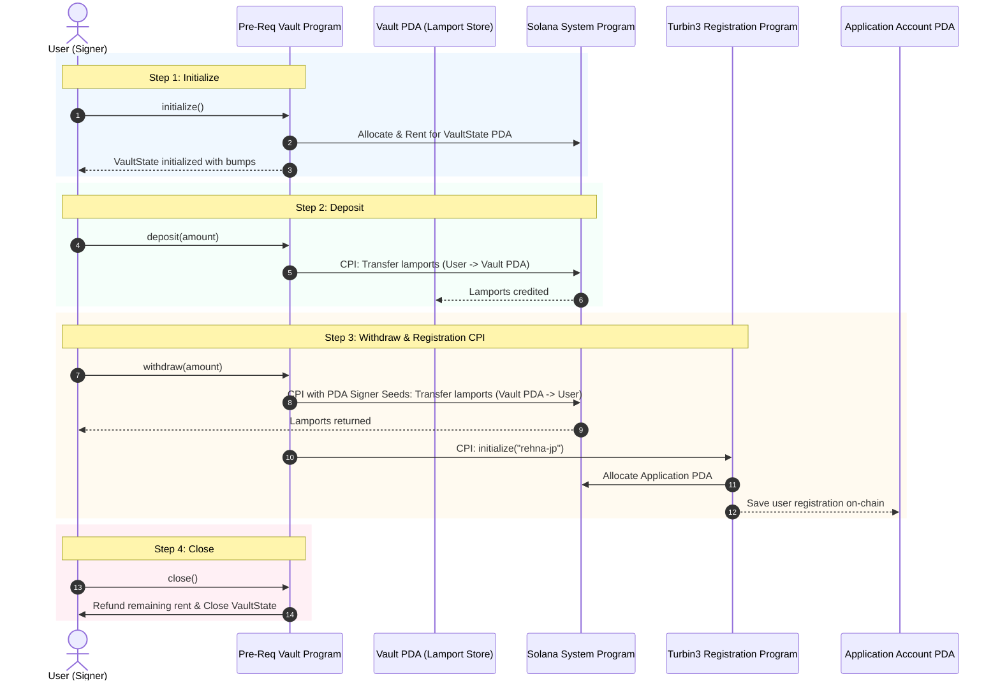

# Turbin3 Builders Cohort — Prerequisite Challenge: Vault Program

This repository contains the completed Anchor Vault Program with Cross-Program Invocation (CPI) integration for the Turbin3 Builders Cohort prerequisite challenge.

---

## Architecture Overview

The program implements a secure personal Vault system on Solana using the Anchor framework. It manages two Program Derived Addresses (PDAs) per user:
1. **`VaultState` PDA**: Stores configuration and bump seeds for authentication.
2. **`Vault` PDA**: An uninitialized System Account that securely holds user lamports.

In addition, during the `withdraw` instruction, the program performs a Cross-Program Invocation (CPI) to the Turbin3 Registration Program to record the applicant's GitHub ID (`rehna-jp`) on-chain.

### Visual Architecture Diagram



### Interaction Flow (Mermaid Diagram)



---

## Account Structures & PDA Derivation

### 1. `VaultState`
- **Seeds**: `[b"state", user.key().as_ref()]`
- **Fields**:
  - `state_bump: u8`: Bump seed for the `VaultState` PDA.
  - `vault_bump: u8`: Bump seed for the `Vault` lamport storage PDA.

### 2. `Vault` (PDA)
- **Seeds**: `[b"vault", state.key().as_ref()]`
- **Owner**: System Program (can safely receive and send lamports when signed with PDA seeds).

### 3. Application Account (CPI Target)
- **Seeds**: `[b"prereq", user.key().as_ref()]`
- **Program ID**: `declarations::registration::ID` (`prereq5723CHyWvcCLRUKvQ5wYWE4...`)

---

## Instructions Implemented

### 1. `initialize`
- Creates the `VaultState` account derived from `[b"state", user.key()]`.
- Persists both `state_bump` and `vault_bump` in the state account.

### 2. `deposit`
- Transfers SOL from the user wallet into the `Vault` PDA.
- Uses `anchor_lang::system_program::transfer` with a CPI context containing `user`, `vault`, and `system_program`.

### 3. `withdraw` (Extended with Registration CPI)
- Transfers SOL from the `Vault` PDA back to the user wallet.
  - Because `vault` is a PDA, signer seeds `&[&[b"vault", state.key().as_ref(), &[state.vault_bump]]]` are passed into `CpiContext::new_with_signer`.
- **Registration CPI**:
  - Prepares the `registration::cpi::accounts::Initialize` struct (`user`, `account`, `system_program`).
  - Calls `registration::cpi::initialize(cpi_ctx, "rehna-jp".to_string())`.

### 4. `close`
- Withdraws any remaining lamports from the `Vault` PDA back to the user.
- Closes the `VaultState` account and refunds rent to `user`.

---

## Building and Testing

### Prerequisites
- Rust & Cargo
- Solana CLI (`v1.18+`)
- Anchor CLI (`v0.30.1` or compatible)
- Node.js & pnpm

### Commands

```bash
# Install dependencies
pnpm install

# Build the Anchor program
anchor build

# Run local or devnet tests
anchor test
```

---

## 3-Minute Video Presentation Script

Below is a concise presentation script tailored for your ≤3 minute video submission:

1. **Introduction (0:00 - 0:30)**:
   - Introduce yourself and the Turbin3 Builders Cohort prerequisite challenge.
   - Mention the purpose of the project: an Anchor Vault program managing user deposits and withdrawals with PDA security and Cross-Program Invocation (CPI).

2. **Architecture & PDAs (0:30 - 1:15)**:
   - Show the architecture diagram from the README.
   - Explain the two PDAs:
     - `state`: Stores the bump seeds, tied to the user.
     - `vault`: Holds the lamports, derived from the state account.
   - Mention why this design prevents unauthorized withdrawals (only the user who matches the state PDA can authorize transactions).

3. **Code Walkthrough & CPI (1:15 - 2:15)**:
   - Open `programs/pre-req-vault/src/instructions/withdraw.rs`.
   - Explain the two CPIs:
     - First CPI: System program transfer using PDA signer seeds (`new_with_signer`).
     - Second CPI: Turbin3 registration CPI calling `registration::cpi::initialize` with your GitHub username (`"rehna-jp"`).

4. **Testing & Demonstration (2:15 - 2:50)**:
   - Run `anchor test` in the terminal to show all tests passing (`initialize`, `deposit`, `withdraw`, `close`).
   - Highlight the devnet transaction signature showing successful verification.

5. **Conclusion (2:50 - 3:00)**:
   - Wrap up with excitement to join the Turbin3 Builders Cohort!
